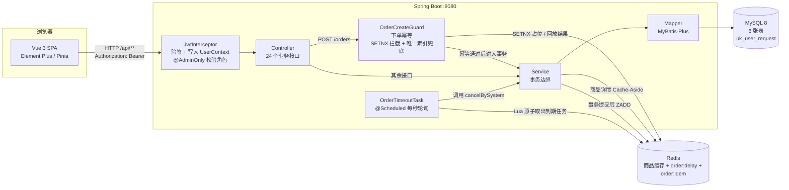

# 简选商城 · JianXuan Mall

一个前后端分离的电商全栈项目：Vue 3 前端 + Spring Boot 3 后端 + MySQL 8。

覆盖商品浏览、购物车、下单、订单状态流转、后台商品与订单管理的完整闭环，**24 个业务接口全部对接真实数据库**，没有 mock。

前端最初是纯静态 + axios-mock-adapter 的页面原型，后端从零手写，逐模块把 mock 替换成真实接口（切换开关仍保留，见「前端 / 后端切换」）。

---

## 技术栈

| 层 | 选型 | 为什么 |
|---|---|---|
| 后端框架 | Spring Boot 3.5.16 / JDK 17 | 主流组合，Jakarta 命名空间 |
| 持久层 | MyBatis-Plus 3.5.18 | 单表 CRUD 免写 XML，复杂查询仍可直接写 SQL |
| 数据库 | MySQL 8 | 事务 + 行锁，防超卖要靠它 |
| 缓存 / 延迟队列 | Redis 5+ | 商品详情 Cache-Aside 缓存；订单超时取消用 ZSet 延迟队列 |
| 认证 | JWT（jjwt 0.12.6）+ BCrypt | 无状态，前后端分离友好 |
| 接口文档 | springdoc-openapi 2.8.9 | Swagger UI 可直接填 token 调试 |
| 前端 | Vue 3 + Vite + Element Plus + Pinia | 组合式 API，开发体验好 |

> 接口文档为什么不是 Knife4j：Knife4j 4.5.0 绑死 springdoc 2.3.0，而 2.3.0 在 Spring Framework 6.2 上会抛 `NoSuchMethodError`；升级 springdoc 后 Knife4j 又反过来调不到新 API。为了不降级 Spring Boot，改用 springdoc 官方 UI。

---

## 功能

### 用户端

| 模块 | 接口 |
|---|---|
| 认证 | 注册、登录、获取当前用户 |
| 商品 | 分类列表、商品分页（关键字 / 分类 / 价格销量排序）、商品详情 |
| 购物车 | 列表、加入（重复商品自动累加）、改数量、删条目、清空 |
| 订单 | 下单（`requestId` 幂等，重复提交只生成一笔）、列表（按状态筛选）、详情、取消、确认收货、**超时未支付自动取消** |

### 管理端（`@AdminOnly`）

| 模块 | 接口 |
|---|---|
| 商品 | 列表（含下架）、新增、编辑、逻辑删除、上下架 |
| 分类 | 列表 |
| 订单 | 全部订单列表（按订单号搜索 / 按状态筛选）、发货 |

---

## 架构



请求进来先过 `JwtInterceptor`：验签通过后把 `userId` / `role` 写进 `ThreadLocal`，业务代码通过 `UserContext` 取当前用户，**任何接口都不接受前端传的 userId**——那是越权的入口。

---

## 快速开始

### 环境

- JDK 17
- Maven 3.9.x（3.10+ 与 IDEA 2024.3 的内嵌 Maven 不兼容，别用）
- MySQL 8
- **Redis 5+**（商品缓存、延迟队列、下单幂等键）
- Node.js **20.19+ 或 22.12+**（Vite 8 的硬性要求；Node 18 会在 `npm install` 阶段直接报 engines 不匹配）

关于 Redis 的可用性边界，说得准确一点：**没启动 Redis 时后端照样能启动，下单也能成功**。
降级后失去的是三样东西，都不是「能不能下单」：商品详情缓存（退化为每次直查数据库）、
下单幂等键（退化为只靠数据库唯一索引）、订单超时自动取消（任务每轮跳过，靠下次启动补灌）。
这是刻意设计的——Redis 在这里是加速器，不是数据库，不能让它变成下单的单点故障。

### 1. 建库并初始化

```bash
# 先把 <db_password> 换成你要用的密码，记录好，下一步要写进 application-local.yml
# 注意：不要用 root 跑应用，给应用单独建一个只有本库权限的账号
mysql -u root -p -e "CREATE DATABASE IF NOT EXISTS jianxuan_mall DEFAULT CHARACTER SET utf8mb4 COLLATE utf8mb4_general_ci;"
mysql -u root -p -e "CREATE USER IF NOT EXISTS 'mall'@'localhost' IDENTIFIED BY '<db_password>'; GRANT ALL ON jianxuan_mall.* TO 'mall'@'localhost';"
```

**执行 SQL 必须带 `--default-character-set=utf8mb4`**，否则中文商品名会报 `Data too long` 或存成乱码。

> ⚠️ **`01`–`06` 是「空库初始化」脚本，不能当升级脚本用。**
> 里面写的是 `DROP TABLE IF EXISTS` 和 `TRUNCATE TABLE`，在已经有数据的库上执行会**直接清空**商品、订单、购物车。
> 只有一个例外：`07` 是真正的增量脚本（加 `request_id` 列 + 唯一索引 + 回填历史数据），
> 全新库和已有库都要跑。注意它**只能成功执行一次**——第二次跑会报
> `Duplicate column name 'request_id'`（列已加过），之后的两句同样会被跳过。
> 看到这个报错就说明增量已经生效，不需要处理；这也是为什么它不是 `01`–`06` 那样的重建脚本。

**首次初始化（空库）**：

```bash
cd backend/src/main/resources/sql
for f in 01_user.sql 02_seed_data.sql 03_product.sql 04_seed_product.sql 05_cart.sql 06_order.sql 07_order_idempotent.sql; do
  mysql -umall -p jianxuan_mall --default-character-set=utf8mb4 < "$f"
done
```

**已有数据的库（只补增量）**：

```bash
cd backend/src/main/resources/sql
# 只跑这一个。跑 01-06 会删表，不是「幂等重跑」而是「重置环境」
mysql -umall -p jianxuan_mall --default-character-set=utf8mb4 < 07_order_idempotent.sql
```

| 文件 | 内容 | 能否在已有数据的库上执行 |
|---|---|---|
| `01_user.sql` | 用户表 | ❌ 会 DROP |
| `02_seed_data.sql` | 演示账号 | ⚠️ 会重复插入（撞唯一索引后报错） |
| `03_product.sql` | 分类 + 商品表 | ❌ 会 DROP |
| `04_seed_product.sql` | 5 个分类 + 17 个商品 | ❌ 会 TRUNCATE |
| `05_cart.sql` | 购物车表（`UNIQUE KEY (user_id, product_id)`） | ❌ 会 DROP |
| `06_order.sql` | 订单 + 订单明细表 | ❌ 会 DROP |
| `07_order_idempotent.sql` | 幂等列 + `uk_user_request` 唯一索引 + 历史数据回填 | ⚠️ 只能成功执行一次（重复执行报列已存在） |

如果要的是「一份可直接还原的完整快照」，用 `db/jianxuan_mall_20261123.sql`（含全部结构和数据）。

### 2. 启动后端

数据库口令和 JWT 密钥**不写在 `application.yml` 里**，而是放在被 `.gitignore` 排除的 `application-local.yml`：

```bash
cd backend/src/main/resources
cp application-local.yml.example application-local.yml
# 然后编辑 application-local.yml，填入下面两项
```

| 配置项 | 说明 |
|---|---|
| `spring.datasource.password` | 建库时给 `mall` 账号设的密码 |
| `jwt.secret` | 至少 32 字节的随机串，`openssl rand -base64 48` 生成 |

`application.yml` 里这两项是 `${DB_PASSWORD}` / `${JWT_SECRET}`，**故意不设默认值**。缺配置时会启动失败并提示 `Could not resolve placeholder` —— 这是有意的：让「没配对」立刻暴露，而不是带着一个默认弱口令静默跑起来。

**Redis 已注册为 Windows 服务**（服务名 `Redis`，开机自启，AOF 持久化已开启），正常开机就在跑，不用手动启动。确认一下即可：

```bash
net start Redis                       # 已在运行时提示「服务已经启动」
D:/redis/redis-cli.exe ping           # 返回 PONG 就行
```

没装 Redis 的机器见 [`docs/环境配置.md`](docs/环境配置.md) 第 6 节。

```bash
# 另开一个终端启动后端
cd backend
mvn spring-boot:run
```

> 测试超时取消时不必真等 30 分钟：`mvn spring-boot:run -Dspring-boot.run.arguments=--order.timeout-minutes=0.2`
> 会把超时改成 12 秒。

- 接口：http://localhost:8080/api/ping
- **接口文档**：http://localhost:8080/swagger-ui.html ← 点 Authorize 填 token 可直接调

### 3. 启动前端

```bash
cd frontend
npm install
npm run dev
```

http://localhost:5173 —— `vite.config.js` 里已配 `/api` 代理到 8080。

### 演示账号

| 账号 | 密码 | 角色 |
|---|---|---|
| `admin` | `admin123` | ADMIN，可进管理后台 |
| `user` | `user123` | USER |

### 4. 跑测试

```bash
cd backend
mvn test
```

只有订单模块的集成测试（5 个），跑在真实 MySQL 上，`@Transactional` 自动回滚、不留脏数据。

**不需要先启动后端** —— `@SpringBootTest` 用 MOCK 环境，不占 8080 端口；但 MySQL 必须在跑。

| 用例 | 验证什么 |
|---|---|
| 下单成功 | 库存扣减、销量增加、金额由服务端重算（不采信前端） |
| 库存不足 | 拒绝下单且不扣库存，消息里点名是哪件商品 |
| 取消订单 | 状态变 CANCELLED，库存和销量都回到原值 |
| 重复取消 | 第二次被拒绝 —— 否则库存会被回补两次 |
| 软删商品后取消 | 库存仍回补，因为 `restoreStock` 的 WHERE 故意不带 `deleted` |

---

## 几个值得说的设计

### 1. 防超卖：判断写进 UPDATE 的 WHERE

```sql
UPDATE product
   SET stock = stock - #{quantity}, sales = sales + #{quantity}
 WHERE id = #{productId}
   AND status = 1
   AND stock >= #{quantity}
```

返回 0 行就抛异常回滚。**「够不够」和「扣减」在同一条语句、同一把行锁里**，不存在「先查再改」的并发窗口。

实测（`python scripts/benchmark.py --scenario oversell`，可复现）：库存 **10**，**32 个并发**同时下单 → 成功 10、失败 22、库存归零，零超卖。

失败的 22 个里，17 个被下单前的预校验拦住，**5 个被这条 UPDATE 的 `stock >= ?` 拦住** —— 那 5 个请求预校验时还看到有库存，扣减那一刻被抢光了。这就是并发窗口，也正是这条 SQL 存在的理由。详见 [压测报告](docs/压测报告.md)。

### 2. 购物车：用唯一键当并发护栏

```java
try {
    cartItemMapper.insert(item);                 // 直接插，赌它不存在
} catch (DuplicateKeyException e) {
    cartItemMapper.increaseQuantity(...);        // 撞了唯一键 → 已存在 → 累加
}
```

`UNIQUE KEY (user_id, product_id)` 由 InnoDB 原子维护，应用层不查存在性，也就没有判断窗口。

实测：20 个请求同时加同一商品 → 0 失败、1 行、数量 20。

### 3. 防 IDOR：所有按 id 的写操作强制带 owner

```sql
UPDATE cart_item SET quantity = ? WHERE id = ? AND user_id = ?
```

拿别人的 `itemId` 来改，命中 0 行，直接当「不存在」处理——连「这个 id 存在」都不泄露。订单同理。

实测：admin 用 user 的 `itemId` / 订单 id → 一律 404。

### 4. 订单号：压测才发现会撞

原方案 `SO + 秒级时间 + 4 位随机`，随机空间 1 万。压测时同一秒进了 138 单，240 单挂了 2 单。改用雪花 ID（`IdWorker.getIdStr()`），修复后 0 失败。详见 [docs/压测报告.md](docs/压测报告.md)。

### 5. 状态机：条件 UPDATE 防重复提交

```java
update().eq(id, orderId).eq(status, PENDING).set(status, SHIPPED)
```

两个管理员同时点发货，第二个命中 0 行直接报错，`shipped_at` 不会被覆盖。取消、确认收货同理。

> 注意它防的是「同一张订单被改两次状态」，防不住「同一个购买意图生成两笔订单」——
> 后者是幂等问题，见下方第 8 节。这两件事经常被混为一谈。

```
PENDING ──发货──> SHIPPED ──确认收货──> COMPLETED
   └──取消──> CANCELLED（取消后不能再发货）
   └──超时30分钟──> CANCELLED（延迟队列触发，见下）
```

### 6. 订单超时取消：ZSet 延迟队列，不是定时扫表

下单成功后往 Redis 的 ZSet 里塞一条任务，`member = orderId`、`score = 到期时间戳`。
调度线程每秒取一次「score ≤ 现在」的任务，取到就调 `cancelBySystem`。

**为什么不用 `@Scheduled` 扫订单表**：扫表要全表扫 `PENDING`，订单量一大就扫不动，精度还受扫描间隔限制。
队列只处理「刚好到期的那几个」，代价是 O(log N + M)。

取任务用 Lua 脚本一次完成「查 + 删」，因为 Redis 执行 Lua 是单线程原子的：

```lua
local jobs = redis.call('ZRANGEBYSCORE', KEYS[1], '-inf', ARGV[1], 'LIMIT', 0, ARGV[2])
if #jobs == 0 then return {} end
redis.call('ZREM', KEYS[1], unpack(jobs))
return jobs
```

如果拆成两次调用，两个调度线程会读到同一批 orderId，同一个订单被取消两次、库存回补两遍。

三个容易踩的点：

| 坑 | 表现 | 解法 |
|---|---|---|
| 在事务里 push | 事务回滚了，Redis 里任务还在，到点去取消不存在的订单 | 挂在 `TransactionSynchronization.afterCommit` 上，只在提交成功后投递 |
| 取任务不用 Lua | 并发下同一订单被处理两次 | 查询和删除放在同一个脚本里，中间插不进别的命令 |
| `rows == 0` 就抛异常 | 用户已付款/已发货时，日志里全是「取消失败」，真故障被淹掉 | 系统任务里状态变更属于正常分支，记 info 后跳过 |

已发货的订单不会被误取消——`cancelBySystem` 里的条件更新是 `eq(status, PENDING)`，
发货之后命中 0 行直接返回。实测：下单后立刻 `PUT` 发货，等超时任务跑到，状态保持 `SHIPPED`、库存不回补。

**可靠性兜底**：Redis 挂了或数据丢了，队列就是空的，那些订单永远等不到取消。
所以应用启动时会把库里所有 `PENDING` 订单重新灌一遍队列（`ZADD` 对同 member 是覆盖语义，幂等）。
队列只是把「多久之后被发现」从小时级缩到秒级，正确性最终不依赖它。

### 7. 商品缓存：Cache-Aside，而且只缓存详情

缓存的判断标准不是「能缓存的都缓存」，而是**能不能说出这个 key 一天读多少次、写多少次**。

| 对象 | 缓存 | 理由 |
|---|---|---|
| 商品详情 | ✅ 30 分钟 + 0~300s 抖动 | 一个 id 一个 key，访问集中在少数热门商品 |
| 分类列表 | ✅ 1 小时 + 0~600s 抖动 | 读极多、写几乎为零 |
| 商品列表 | ❌ | key 由关键字/分类/排序/页码组合而成，命中率低、白占内存 |

写路径是「**先更库、再删缓存**」，两个顺序问题都不能反：

- **删缓存而不是更新缓存**：并发写时「更新缓存」的落库顺序可能和「改库」颠倒，缓存会永久变脏；
  删除是幂等的，把一致性责任交给下一次读。
- **先更库再删**：反过来会留下「删完缓存、更库生效前，读请求把旧值写回」的脏数据。

三个经典问题按数据规模选方案，没有一味堆组件：

| 问题 | 本项目的做法 | 为什么不是另一个 |
|---|---|---|
| 穿透（查不存在的 id） | 空值 `__NULL__` 缓存 60s | 布隆过滤器要维护全量 id、不支持删除、还要加组件；这里 id 空间才十几个 |
| 击穿（热点 key 过期） | SETNX 抢锁重建，其余线程等 50ms 重读，锁用 Lua 比对 token 释放 | 逻辑过期不阻塞但会返回陈旧数据，库存/价格对准确性敏感 |
| 雪崩（批量同时过期） | TTL 加随机偏移 | —— |

**最麻烦的是库存**：详情里带着 `stock` / `sales`，而每笔订单都会改它们。
所以下单扣库存（`afterCommit` 里）、取消回补库存之后，都要删掉对应商品的详情缓存，
否则用户会在 TTL 内一直看到旧库存。代价是热点商品缓存频繁失效——接受它，因为
详情是「读远多于写」，且库存准确性比命中率重要。量级再大就把库存拆成独立接口，
详情只缓存静态字段（这是面试问「怎么演进」时的答案）。

**Redis 挂了不能把业务带走**：所有缓存调用 try/catch 降级直查库，再加一个 5 秒熔断
（`CacheHealth`，一个 volatile 时间戳，没引 Resilience4j）。只做降级是不够的——
一次详情要碰三次缓存，串行等超时会导致接口慢到 10 秒：

| Redis 停机后 | 只有降级 | 降级 + 熔断 |
|---|---|---|
| 第 1 次请求 | 10.05 s | 2.55 s |
| 后续请求 | 10.0 s | **4.3 ms** |

验证缓存有没有真生效，不能只看接口返回：**绕过接口直接改数据库，再请求接口**——
如果它仍返回旧值，才证明读的是缓存。另外用 `Com_select` 前后差值量化防击穿：
50 并发打同一个刚过期的商品，数据库只被查了 **3** 次（无锁是 100 次）。

设计细节与 12 道面试题见 [docs/M8-商品缓存.md](docs/M8-商品缓存.md)。

### 8. 下单幂等：Redis 拦截 + 唯一索引兜底

「防超卖」和「幂等」是两个问题。前者保证不卖超，后者保证**一次购买意图只落一笔订单**。
用户手抖点两次、或前端 15 秒超时后自动重试（更隐蔽，用户完全无感知），都会变成两笔订单、
扣两次库存。

客户端在结算页生成一个 `requestId`（`crypto.randomUUID()`），重试时保持不变。服务端：

1. **Redis `SETNX` 占位**（`order:idem:{userId}:{requestId}`，TTL 30s）。抢不到说明是重复请求，
   直接回放上次结果——**连事务都不开，一行 SQL 都不执行**。
2. **数据库唯一索引 `uk_user_request (user_id, request_id)`**。Redis 挂了、key 过期了、
   并发刚好穿过 SETNX，都拦不住，但两笔请求带同一个 requestId 最多只能落一行。

值有两态：`PROCESSING`（首次还在跑，重复请求返回 409「请勿重复提交」）→ 订单 ID
（已完成，直接返回同一笔订单，200）。**失败必须释放幂等键**，否则用户买多了被拒后，
改数量再提交会被自己的失败请求挡住 30 秒。

两个容易踩的坑：

- **兜底 `catch (DuplicateKeyException)` 必须在事务外层。** `@Transactional` 方法内捕获后继续
  查库，方法返回时提交会抛 `UnexpectedRollbackException`；而且同一个类自我调用不走代理，
  `@Transactional` 会静默失效。所以幂等逻辑独立成 `OrderCreateGuard`。
- **加唯一索引前必须回填历史数据。** `request_id NOT NULL DEFAULT ''`，不回填的话
  `(user_id, '')` 立刻冲突，同一用户只能留一张历史订单。

实测：同一 requestId 连提 3 次返回同一订单号、库存只扣一次；10 并发全部 200 且只有一笔订单；
**把 Redis 整个停掉再提两次，第二次仍返回同一笔订单**（走唯一索引兜底）。

设计细节与 9 道面试题见 [docs/M9-下单幂等.md](docs/M9-下单幂等.md)。

---

## 压测结果

单机（客户端与服务端同机），脚本见 `scripts/benchmark.py`。

| 场景 | 结果 | 说明 |
|---|---|---|
| **超卖验证（10 件库存 / 32 并发）** | **0 超卖** | 成功 10、剩余库存 0，22 个失败全是业务拒绝 |
| 商品列表（8 进程） | ~2400 QPS | 客户端已到采样上限，服务端未饱和 |
| 下单（单商品，8 并发） | 145 QPS | 受热点行锁限制 |
| 下单（分散 20 商品） | 506 QPS | 同样的代码，锁粒度不同，差 3.5 倍 |
| 单请求基线 | 读 1.6ms / 下单 7.6ms | 单线程串行 20 次平均 |

排查过程（订单号 bug → 连接池无效 → 日志开销 → 客户端 GIL → 行锁竞争）完整记录在 [docs/压测报告.md](docs/压测报告.md)。

```bash
python scripts/benchmark.py -c 32 -n 500          # 读 + 写 + 超卖
python scripts/benchmark.py --scenario oversell   # 只验证超卖
```

---

## 项目结构

```
Jack项目/
├── backend/
│   ├── pom.xml
│   ├── src/main/
│   │   ├── java/com/jack/jianxuan/
│   │   │   ├── annotation/      @AdminOnly
│   │   │   ├── common/          Result / BusinessException / GlobalExceptionHandler / UserContext / CacheHealth
│   │   │   ├── config/          MyBatis-Plus 分页、BCrypt、拦截器注册、OpenAPI
│   │   │   ├── controller/      用户端与管理端接口
│   │   │   ├── dto/             请求 DTO 与响应 VO
│   │   │   ├── entity/          6 张表的实体
│   │   │   ├── interceptor/     JWT 验签 + 角色校验
│   │   │   ├── mapper/          MyBatis-Plus Mapper
│   │   │   ├── service/         业务逻辑与事务（OrderCreateGuard 幂等、OrderDelayQueue 延迟队列、ProductCache 商品缓存）
│   │   │   ├── task/            OrderTimeoutTask（超时扫描 + 启动补灌）
│   │   │   └── util/            JwtUtil
│   │   └── resources/
│   │       ├── application.yml               主配置（口令/密钥为环境变量占位符）
│   │       ├── application-local.yml.example 本地配置模板（复制为 .yml 后填真实值）
│   │       └── sql/             01-06 建表与种子数据，07 为幂等增量脚本
│   └── src/test/java/com/jack/jianxuan/service/   OrderServiceTest（下单 / 取消集成测试）
├── frontend/                    Vue 3 前端
├── docs/                        各模块代码讲解、环境配置、API 文档、压测报告
└── scripts/
    ├── benchmark.py             压测脚本（读 / 写 / 超卖三个场景）
    └── cleanup_bench.sql        清理压测产生的订单与商品
```

`docs/` 里有每个模块的详细讲解（M0-M9），包含设计取舍、踩过的坑和面试自测题：

| 文档 | 内容 |
|---|---|
| [环境配置.md](docs/环境配置.md) | JDK / Maven / MySQL / Redis 安装与踩坑 |
| [api.md](docs/api.md) | 全部接口的请求响应约定 |
| [M0-M5 代码讲解](docs/) | 统一返回体、JWT、商品、购物车、订单、管理端 |
| [M7-订单超时取消.md](docs/M7-订单超时取消.md) | ZSet 延迟队列的设计取舍与实测 |
| [M8-商品缓存.md](docs/M8-商品缓存.md) | Cache-Aside、穿透/击穿/雪崩、降级熔断、12 道面试题 |
| [M9-下单幂等.md](docs/M9-下单幂等.md) | 两层幂等、事务边界的坑、9 道面试题 |
| [压测报告.md](docs/压测报告.md) | 压测数据与瓶颈排查全过程 |

---

## 前端 / 后端切换

`src/mock/index.js` 里保留了完整的假数据实现，按模块开关：

```js
const MOCK_AUTH = false
const MOCK_PRODUCT = false
const MOCK_CART = false
const MOCK_ORDER = false
```

**只改开关是不够的**：只要注册过 handler，axios-mock-adapter 就会拦下请求，不会自动落到真实后端。所以每个模块在 `else` 分支里都写了显式 `.passThrough()`。这个坑踩过一次，记在 [环境配置.md](docs/环境配置.md) 里。

---

## 已知限制

- **没有真实支付**：下单即算「待发货」，没有支付网关，所以超时取消的依据是「30 分钟未发货」
- **Redis 用在三处**：商品缓存、延迟队列、下单幂等键。热点行锁的优化手段（库存分桶、预扣、队列削峰）都没做，原因见压测报告
- **幂等键不做过期后的语义保证**：`requestId` 在 Redis 里存 24 小时，超期后同一个 ID 理论上能再下一单
  （唯一索引也只约束到那时为止）。实际客户端每天都会生成新的 UUID，不会触发
- **没有防刷单限流**：幂等只保证「同一个请求不重复」，挡不住「每次换一个 requestId 高频下单」。
  那是限流/风控的职责，本项目没做
- **缓存删除失败只靠 TTL 兜底**：改商品时删缓存失败只记日志，最多脏 30 分钟。
  彻底解决要靠删缓存重试队列或订阅 binlog（Canal），本项目没上
- **延迟任务的重试是「3 次后转死信」而不是自动修复**：失败订单会进 `order:delay:dead`，
  需要人工捞出来处理。没有做死信的自动重放界面
- **单机部署**：雪花 ID 的机器号由 MyBatis-Plus 自动推导，多实例部署需要显式配置 workerId
- **前端最大包仍是 950 KB**：Element Plus 是 `app.use(ElementPlus)` 全量引入，
  路由已经懒加载、图标已经改成按需（省了约 144 KB），但组件库本体还是一次性打进主包。
  要根治得换成 `unplugin-vue-components` 按需组件引入，本项目没做（见 [`docs/M10-代码评审修复.md`](docs/M10-代码评审修复.md)）
- **测试覆盖仍然有限**：24 个用例集中在「订单 + 幂等 + 缓存一致性 + 缓存失效容错 + 超时任务容错 + 注册校验」，
  用户/购物车/商品管理仍靠 `curl` 手工验证。
  真正的并发超卖没法用 JUnit 覆盖——测试事务里看不到其他线程未提交的数据，
  那部分由 `benchmark.py --scenario oversell` 承担（幂等的并发用例是例外：它刻意不加测试事务）
