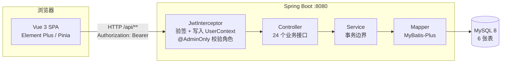

# 简选商城 · JianXuan Mall

一个前后端分离的电商全栈项目：Vue 3 前端 + Spring Boot 3 后端 + MySQL 8。

覆盖商品浏览、购物车、下单、订单状态流转、后台商品与订单管理的完整闭环，**24 个业务接口全部对接真实数据库**，没有 mock。

前端最初是纯静态 + axios-mock-adapter 的页面原型，后端从零手写，逐模块把 mock 替换成真实接口（切换开关仍保留，见「前端 / 后端切换」）。

---

## 技术栈

| 层 | 选型 | 为什么 |
|---|---|---|
| 后端框架 | Spring Boot 3.5.16 / JDK 17 | 主流组合，Jakarta 命名空间 |
| 持久层 | MyBatis-Plus 3.5.18 | 单表 CRUD 免写 XML，复杂查询仍可直接写 SQL |
| 数据库 | MySQL 8 | 事务 + 行锁，防超卖要靠它 |
| 认证 | JWT（jjwt 0.12.6）+ BCrypt | 无状态，前后端分离友好 |
| 接口文档 | springdoc-openapi 2.8.9 | Swagger UI 可直接填 token 调试 |
| 前端 | Vue 3 + Vite + Element Plus + Pinia | 组合式 API，开发体验好 |

> 接口文档为什么不是 Knife4j：Knife4j 4.5.0 绑死 springdoc 2.3.0，而 2.3.0 在 Spring Framework 6.2 上会抛 `NoSuchMethodError`；升级 springdoc 后 Knife4j 又反过来调不到新 API。为了不降级 Spring Boot，改用 springdoc 官方 UI。

---

## 功能

### 用户端

| 模块 | 接口 |
|---|---|
| 认证 | 注册、登录、获取当前用户 |
| 商品 | 分类列表、商品分页（关键字 / 分类 / 价格销量排序）、商品详情 |
| 购物车 | 列表、加入（重复商品自动累加）、改数量、删条目、清空 |
| 订单 | 下单、列表（按状态筛选）、详情、取消、确认收货 |

### 管理端（`@AdminOnly`）

| 模块 | 接口 |
|---|---|
| 商品 | 列表（含下架）、新增、编辑、逻辑删除、上下架 |
| 分类 | 列表 |
| 订单 | 全部订单列表（按订单号搜索 / 按状态筛选）、发货 |

---

## 架构



请求进来先过 `JwtInterceptor`：验签通过后把 `userId` / `role` 写进 `ThreadLocal`，业务代码通过 `UserContext` 取当前用户，**任何接口都不接受前端传的 userId**——那是越权的入口。

---

## 快速开始

### 环境

- JDK 17
- Maven 3.9.x（3.10+ 与 IDEA 2024.3 的内嵌 Maven 不兼容，别用）
- MySQL 8
- Node.js 18+

### 1. 建库并初始化

```bash
# 先把 <db_password> 换成你要用的密码，记录好，下一步要写进 application-local.yml
# 注意：不要用 root 跑应用，给应用单独建一个只有本库权限的账号
mysql -u root -p -e "CREATE DATABASE IF NOT EXISTS jianxuan_mall DEFAULT CHARACTER SET utf8mb4 COLLATE utf8mb4_general_ci;"
mysql -u root -p -e "CREATE USER IF NOT EXISTS 'mall'@'localhost' IDENTIFIED BY '<db_password>'; GRANT ALL ON jianxuan_mall.* TO 'mall'@'localhost';"
```

**执行 SQL 必须带 `--default-character-set=utf8mb4`**，否则中文商品名会报 `Data too long` 或存成乱码。

```bash
cd backend/src/main/resources/sql
for f in 01_user.sql 02_seed_data.sql 03_product.sql 04_seed_product.sql 05_cart.sql 06_order.sql; do
  mysql -umall -p jianxuan_mall --default-character-set=utf8mb4 < "$f"
done
```

| 文件 | 内容 |
|---|---|
| `01_user.sql` | 用户表 |
| `02_seed_data.sql` | 演示账号 |
| `03_product.sql` | 分类 + 商品表 |
| `04_seed_product.sql` | 5 个分类 + 16 个商品 |
| `05_cart.sql` | 购物车表（`UNIQUE KEY (user_id, product_id)`） |
| `06_order.sql` | 订单 + 订单明细表 |

### 2. 启动后端

数据库口令和 JWT 密钥**不写在 `application.yml` 里**，而是放在被 `.gitignore` 排除的 `application-local.yml`：

```bash
cd backend/src/main/resources
cp application-local.yml.example application-local.yml
# 然后编辑 application-local.yml，填入下面两项
```

| 配置项 | 说明 |
|---|---|
| `spring.datasource.password` | 建库时给 `mall` 账号设的密码 |
| `jwt.secret` | 至少 32 字节的随机串，`openssl rand -base64 48` 生成 |

`application.yml` 里这两项是 `${DB_PASSWORD}` / `${JWT_SECRET}`，**故意不设默认值**。缺配置时会启动失败并提示 `Could not resolve placeholder` —— 这是有意的：让「没配对」立刻暴露，而不是带着一个默认弱口令静默跑起来。

```bash
cd backend
mvn spring-boot:run
```

- 接口：http://localhost:8080/api/ping
- **接口文档**：http://localhost:8080/swagger-ui.html ← 点 Authorize 填 token 可直接调

### 3. 启动前端

```bash
cd frontend
npm install
npm run dev
```

http://localhost:5173 —— `vite.config.js` 里已配 `/api` 代理到 8080。

### 演示账号

| 账号 | 密码 | 角色 |
|---|---|---|
| `admin` | `admin123` | ADMIN，可进管理后台 |
| `user` | `user123` | USER |

---

## 几个值得说的设计

### 1. 防超卖：判断写进 UPDATE 的 WHERE

```sql
UPDATE product
   SET stock = stock - #{quantity}, sales = sales + #{quantity}
 WHERE id = #{productId}
   AND status = 1
   AND stock >= #{quantity}
```

返回 0 行就抛异常回滚。**「够不够」和「扣减」在同一条语句、同一把行锁里**，不存在「先查再改」的并发窗口。

实测：库存 5，20 个线程同时下单 → 成功 5、失败 15、库存归零、订单数 5，零超卖。

### 2. 购物车：用唯一键当并发护栏

```java
try {
    cartItemMapper.insert(item);                 // 直接插，赌它不存在
} catch (DuplicateKeyException e) {
    cartItemMapper.increaseQuantity(...);        // 撞了唯一键 → 已存在 → 累加
}
```

`UNIQUE KEY (user_id, product_id)` 由 InnoDB 原子维护，应用层不查存在性，也就没有判断窗口。

实测：20 个请求同时加同一商品 → 0 失败、1 行、数量 20。

### 3. 防 IDOR：所有按 id 的写操作强制带 owner

```sql
UPDATE cart_item SET quantity = ? WHERE id = ? AND user_id = ?
```

拿别人的 `itemId` 来改，命中 0 行，直接当「不存在」处理——连「这个 id 存在」都不泄露。订单同理。

实测：admin 用 user 的 `itemId` / 订单 id → 一律 404。

### 4. 订单号：压测才发现会撞

原方案 `SO + 秒级时间 + 4 位随机`，随机空间 1 万。压测时同一秒进了 138 单，240 单挂了 2 单。改用雪花 ID（`IdWorker.getIdStr()`），修复后 0 失败。详见 [docs/压测报告.md](docs/压测报告.md)。

### 5. 状态机：条件 UPDATE 防重复提交

```java
update().eq(id, orderId).eq(status, PENDING).set(status, SHIPPED)
```

两个管理员同时点发货，第二个命中 0 行直接报错，`shipped_at` 不会被覆盖。取消、确认收货同理。

```
PENDING ──发货──> SHIPPED ──确认收货──> COMPLETED
   └──取消──> CANCELLED（取消后不能再发货）
```

---

## 压测结果

单机（客户端与服务端同机），脚本见 `scripts/benchmark.py`。

| 场景 | QPS | 说明 |
|---|---|---|
| 商品列表（8 进程） | ~2400 | 客户端已到采样上限，服务端未饱和 |
| 下单（单商品，8 并发） | 145 | 受热点行锁限制 |
| 下单（分散 20 商品） | 506 | 同样的代码，锁粒度不同，差 3.5 倍 |
| 单请求基线 | 读 1.6ms / 下单 7.6ms | 单线程串行 20 次平均 |

排查过程（订单号 bug → 连接池无效 → 日志开销 → 客户端 GIL → 行锁竞争）完整记录在 [docs/压测报告.md](docs/压测报告.md)。

```bash
python scripts/benchmark.py -c 32 -n 500
```

---

## 项目结构

```
Jack项目/
├── backend/
│   ├── pom.xml
│   └── src/main/
│       ├── java/com/jack/jianxuan/
│       │   ├── annotation/      @AdminOnly
│       │   ├── common/          Result / BusinessException / GlobalExceptionHandler / UserContext
│       │   ├── config/          MyBatis-Plus 分页、BCrypt、拦截器注册、OpenAPI
│       │   ├── controller/      用户端与管理端接口
│       │   ├── dto/             请求 DTO 与响应 VO
│       │   ├── entity/          6 张表的实体
│       │   ├── interceptor/     JWT 验签 + 角色校验
│       │   ├── mapper/          MyBatis-Plus Mapper
│       │   ├── service/         业务逻辑与事务
│       │   └── util/            JwtUtil
│       └── resources/
│           ├── application.yml              主配置（口令/密钥为环境变量占位符）
│           ├── application-local.yml.example 本地配置模板（复制为 .yml 后填真实值）
│           └── sql/             01-06 建表与种子数据
├── frontend/                    Vue 3 前端
├── docs/                        各模块代码讲解、环境配置、API 文档、压测报告
└── scripts/benchmark.py         压测脚本
```

`docs/` 里有每个模块的详细讲解（M0-M5），包含设计取舍、踩过的坑和面试自测题：

| 文档 | 内容 |
|---|---|
| [环境配置.md](docs/环境配置.md) | JDK / Maven / MySQL 安装与踩坑 |
| [api.md](docs/api.md) | 全部接口的请求响应约定 |
| [M0-M5 代码讲解](docs/) | 统一返回体、JWT、商品、购物车、订单、管理端 |
| [压测报告.md](docs/压测报告.md) | 压测数据与瓶颈排查全过程 |

---

## 前端 / 后端切换

`src/mock/index.js` 里保留了完整的假数据实现，按模块开关：

```js
const MOCK_AUTH = false
const MOCK_PRODUCT = false
const MOCK_CART = false
const MOCK_ORDER = false
```

**只改开关是不够的**：只要注册过 handler，axios-mock-adapter 就会拦下请求，不会自动落到真实后端。所以每个模块在 `else` 分支里都写了显式 `.passThrough()`。这个坑踩过一次，记在 [环境配置.md](docs/环境配置.md) 里。

---

## 已知限制

- **没有真实支付**：下单即算「待发货」，没有支付网关
- **没有 Redis / MQ**：热点行锁的优化手段（库存分桶、预扣、队列削峰）都没做，原因见压测报告
- **单机部署**：雪花 ID 的机器号由 MyBatis-Plus 自动推导，多实例部署需要显式配置 workerId
- **无自动化测试**：验证靠 `curl` / 脚本实测，没有写 JUnit
